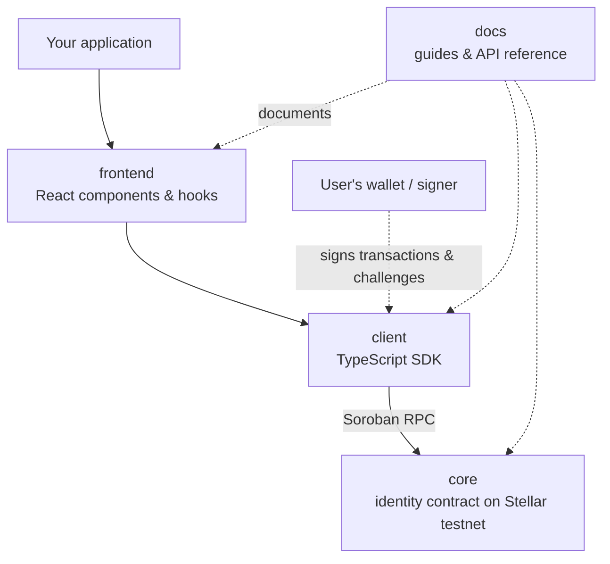

<div align="center">

# Stellar ID

**Decentralized identity and sign-in for Stellar: a Soroban DID & credential registry, a TypeScript SDK, React components and documentation.**


</div>

> **Status.** Testnet only, v0.x, self-reviewed but **not independently audited**. Mainnet is an explicit non-goal
> for v1. The packages are not yet published to npm.

---

## What is this?

Stellar ID gives an application three things that passwords and OAuth do not:

1. **An identity the user owns.** A `did:stellar` identifier derived from the user's own Stellar account, with
   keys and service endpoints recorded on-chain.
2. **Sign-in by signature.** The user proves control of their DID by signing a one-time challenge — no password,
   no third-party identity provider.
3. **Credentials that can be revoked.** Issuers anchor a *hash* of a credential on-chain; anyone can check
   whether it is still valid, while the credential itself — and any personal data in it — stays off-chain.

```
did:stellar:testnet:GABCD…XYZ
```

## The four repositories

The suite is developed here as a monorepo and published as four repositories. Dependencies flow one way:
**core → client → frontend → docs**.

| Repository | Folder here | Language | What it is |
|---|---|---|---|
| [**core**](https://github.com/Stellar-IDs/core) | `stellar-id-core/` | Rust (Soroban) | The on-chain registry: DID lifecycle, credential anchoring, revocation, Ed25519 proof checks. 14 public functions, 59 tests. |
| [**client**](https://github.com/Stellar-IDs/client) | `stellar-id-client/` | TypeScript | The SDK: create / resolve / update / deactivate DIDs, issue / verify / revoke credentials, challenge sign-in, wallet adapters. npm name `stellar-id-client`. |
| [**frontend**](https://github.com/Stellar-IDs/frontend) | `stellar-id-frontend/` | React / Next.js | `SessionProvider`, `IdentityLogin`, `IdentityProfile`, `CredentialBadge`, `withAuth`, CSS-variable theming, and a Next.js demo. npm name `stellar-id-frontend`. |
| [**docs**](https://github.com/Stellar-IDs/docs) | `stellar-id-docs/` | Docusaurus | Concepts, quick starts, API references, security guidance. |

## How the pieces fit



## What works today

- The contract is **deployed on testnet** with its full DID and credential lifecycle
  (`CB2ZHW3TBCVXQ22CLWUTIOJVCIS4CLGFX4WHLZQ663XSGKVYKFUBLZAT`).
- The SDK runs create → resolve → update → issue → verify → revoke → deactivate **end to end against testnet**.
- The demo app registers a DID, signs in with a challenge, issues and revokes a credential and shows the badge
  change, covered by a Playwright test (using a throwaway keypair).
- The docs site builds with link checking; its Node quick start was run verbatim from a clean folder.

## What does not work yet

- Packages are **not on npm**; the frontend cannot install until the client is published.
- **Real browser-extension wallets** (Freighter, xBull, …) have not been tested through the SDK or the demo.
- No hosted demo or docs site.
- No independent security audit; mainnet unsupported.
- Open contributor work is tracked as issues in each repository (method registration, more proof types,
  revocation lists, resolver fallback, wallet connectors, theming, accessibility audit, more guides).

## Working in this monorepo

Each folder builds, tests and lints on its own and never imports from a sibling by path — that is what makes the
four-way split possible.

```bash
# everything
scripts/verify-all.sh            # on Windows: Git Bash

# a single package
cd stellar-id-core     && cargo fmt --check && cargo clippy --all-targets -- -D warnings && cargo test && stellar contract build
cd stellar-id-client   && pnpm install --frozen-lockfile && pnpm lint && pnpm typecheck && pnpm test && pnpm build
```

`scripts/split.sh` produces the four standalone repositories (`core`, `client`, `frontend`, `docs`) from this
history without modifying it.

Project documents: [`AGENTS.md`](AGENTS.md) (working rules), [`PLAYBOOK.md`](PLAYBOOK.md) (the build plan) and
[`STATUS.md`](STATUS.md) (progress, decisions and pinned versions).

## License

[Apache-2.0](stellar-id-core/LICENSE). Each package carries its own copy; root-level files are not carried over
when the monorepo is split.
