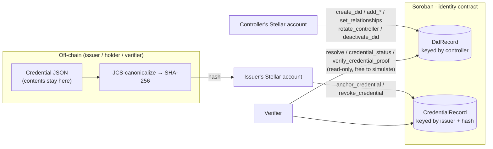

<div align="center">

# Stellar ID — Core

**An on-chain identity registry for Stellar: `did:stellar` decentralized identifiers, credential anchoring and revocation, as a single Soroban smart contract.**

[](https://github.com/Stellar-IDs/core/actions/workflows/ci.yml)


[Method spec](docs/METHOD_SPEC.md) · [Security review](docs/SECURITY_REVIEW.md) · [Fee measurements](docs/COSTS.md) · [Changelog](CHANGELOG.md)

</div>

> **Status — read this first.** This contract runs on **Stellar testnet only**. It has had a
> self-review ([`docs/SECURITY_REVIEW.md`](docs/SECURITY_REVIEW.md)) but **no independent audit**,
> and mainnet deployment is an explicit non-goal for v1. Do not anchor anything of real value to it.

---

## Table of contents

1. [What this is](#what-this-is)
2. [Why it exists](#why-it-exists)
3. [How it works](#how-it-works)
4. [Try it in 60 seconds](#try-it-in-60-seconds)
5. [Contract reference](#contract-reference)
6. [Data model and limits](#data-model-and-limits)
7. [Authorization model](#authorization-model)
8. [Storage, TTL and cost](#storage-ttl-and-cost)
9. [Privacy](#privacy)
10. [Security posture](#security-posture)
11. [Deployment](#deployment)
12. [Development](#development)
13. [Repository layout](#repository-layout)
14. [Scope: implemented, and not yet](#scope-implemented-and-not-yet)
15. [The Stellar ID suite](#the-stellar-id-suite)
16. [Contributing, security and license](#contributing-security-and-license)

---

## What this is

`core` is the on-chain half of the Stellar ID suite. It is one Soroban contract that stores three
kinds of facts and nothing else:

| Fact | What is stored on-chain | What is **not** stored on-chain |
|---|---|---|
| **A DID document** | The controller address, Ed25519 public keys, which keys may authenticate or assert, https service endpoints, timestamps, a version counter and a deactivated flag | Names, emails, documents, or any personal data |
| **An anchored credential** | The issuer address, the SHA-256 hash of the credential, when it was anchored, an optional expiry and a revoked flag | The credential itself — its contents stay with the issuer and the holder |
| **A state change** | An event for every create, update, deactivate, rotate, anchor and revoke | — |

A DID is derived directly from a Stellar account address:

```
did:stellar:<network>:<G... account address>
did:stellar:testnet:GABCD…XYZ
```

There is no separate identifier to generate and no registry lookup to perform. The account that
controls the DID is the account whose address appears in it, and the contract enforces that with
Stellar's native `require_auth`.

## Why it exists

Passwords and OAuth tie a person's identity to an operator who can lock them out or leak their data.
Stellar already gives every user a key pair and every app a way to check a signature. What it lacks is
a standard, queryable place to say *"this key belongs to this identity, here is how to reach its
services, and here is a credential that was issued to it — and whether it has been revoked since."*

This contract provides exactly that registry, and keeps it small enough to read in one sitting
(about 21 KB of wasm and 14 public functions).

**Design choices worth knowing:**

- **The Stellar address *is* the identifier.** One account, one DID. This is a deliberate difference
  from registry-style methods that mint opaque IDs.
- **Hashes, not credentials.** Only a hash and a status flag go on-chain, so revocation is publicly
  checkable without making the credential public.
- **Everything is bounded.** Every collection and string has a hard size cap, so no caller can grow a
  record without limit.
- **Every state change emits an event**, so indexers can follow the registry without polling.

> **Name conflict.** Another project (ACTA-Team) already documents a `did:stellar` method with a
> different identifier scheme. Both are drafts. [`docs/METHOD_SPEC.md`](docs/METHOD_SPEC.md) §12 and its
> annex compare the two and describe the rename path (`did:stellar-id`) if the W3C registry requires it.

## How it works



1. **Create.** An account calls `create_did` with an initial document. The contract checks the caller
   controls that address, validates sizes, stores one persistent entry and emits `DidCreated`.
2. **Maintain.** The controller adds or removes verification methods and services, and chooses which
   keys appear in `authentication` (sign in) and `assertion_method` (issue credentials).
3. **Issue.** An issuer with an active DID hashes a credential off-chain and calls
   `anchor_credential`. Anyone can later ask `credential_status`.
4. **Verify.** A verifier recomputes the hash, checks `credential_status`, and can have the contract
   check an Ed25519 signature against the issuer's `assertion_method` key with
   `verify_credential_proof`.
5. **Revoke or retire.** The issuer revokes a hash; the controller can deactivate the whole DID, which
   becomes a read-only tombstone.

The canonicalization and hashing rules (JCS + SHA-256) and the exact bytes signed are specified in
[`docs/METHOD_SPEC.md`](docs/METHOD_SPEC.md) §6, with cross-language fixtures in
[`docs/test-vectors.json`](docs/test-vectors.json) that the TypeScript SDK also tests against.

## Try it in 60 seconds

You need the [Stellar CLI](https://developers.stellar.org) (28.x). This uses the testnet deployment
and a throwaway funded identity — **never reuse a testnet key on mainnet**.

```bash
# 1. A fresh, friendbot-funded testnet identity
stellar keys generate me --network testnet --fund
ID=CB2ZHW3TBCVXQ22CLWUTIOJVCIS4CLGFX4WHLZQ663XSGKVYKFUBLZAT
ME=$(stellar keys address me)

# 2. Register an empty DID for that account
stellar contract invoke --id $ID --source-account me --network testnet -- \
  create_did --controller $ME \
  --doc "{\"controller\":\"$ME\",\"verification_methods\":[],\"authentication\":[],\"assertion_method\":[],\"services\":[]}"

# 3. Read it back (read-only, no fee)
stellar contract invoke --id $ID --source-account me --network testnet --send=no -- \
  resolve --controller $ME
```

Most applications should not call the contract by hand — use the TypeScript SDK
([`Stellar-IDs/client`](https://github.com/Stellar-IDs/client)), which adds typed errors, W3C
document rendering, credential helpers and sign-in challenges.

## Contract reference

All functions live on `IdentityContract` (`contracts/identity/src/lib.rs`).

### DID lifecycle

| Function | Auth | Effect |
|---|---|---|
| `create_did(controller, doc)` | `controller` | Creates the DID for `controller`. Fails with `AlreadyExists` if one exists. Emits `DidCreated`. |
| `resolve(controller)` | none (read-only) | Returns the `DidRecord`, including deactivated tombstones. `NotFound` if absent. |
| `add_verification_method(controller, vm)` | `controller` | Adds an Ed25519 key with an id such as `key-1`. Bumps `version`; emits `DidUpdated`. |
| `remove_verification_method(controller, vm_id)` | `controller` | Removes a key. Refused with `InvalidVerificationMethod` while a relationship still references it. |
| `set_relationships(controller, authentication, assertion_method)` | `controller` | Chooses which existing key ids may authenticate and which may assert/issue. |
| `add_service(controller, svc)` / `remove_service(controller, svc_id)` | `controller` | Manages https service endpoints. |
| `rotate_controller(controller, new_controller)` | **both** addresses | Moves the record to a new controller address. The old address then resolves to `NotFound`. Emits `DidControllerRotated`. |
| `deactivate_did(controller)` | `controller` | Permanently tombstones the DID. All further mutation is rejected with `Deactivated`. |
| `bump_ttl(controller)` | none | Extends the DID entry's storage lifetime. Works on tombstones too. |

### Credentials

| Function | Auth | Effect |
|---|---|---|
| `anchor_credential(issuer, credential_hash, expires_at)` | `issuer` | Records a 32-byte credential hash with an optional expiry. The issuer must own a **non-deactivated** DID. A hash can be anchored once per issuer. Emits `CredentialAnchored`. |
| `revoke_credential(issuer, credential_hash)` | `issuer` | Marks the hash revoked. Allowed even after the issuer's DID is deactivated (a deliberate safety action). A second revoke returns `Revoked`. Emits `CredentialRevoked`. |
| `credential_status(issuer, credential_hash)` | none (read-only) | Returns `Unknown`, `Active`, `Revoked` or `Expired`. `Revoked` outranks `Expired`; expiry is inclusive (`now >= expires_at`). |
| `verify_credential_proof(issuer, vm_id, message_hash, signature)` | none (read-only) | Checks the issuer's DID is active, that `vm_id` is in `assertion_method` and is Ed25519, then verifies the signature over `message_hash`. **A bad signature traps** rather than returning an error. |

### Errors

Errors are a `#[contracterror]` enum. Each variant carries a doc comment that begins with its own name —
that is load-bearing: generated clients build their error messages from it, and the TypeScript SDK maps
errors by name.

| Code | Variant | Meaning |
|---:|---|---|
| 1 | `NotFound` | No DID or credential record for this key |
| 2 | `AlreadyExists` | DID, method, service or credential already exists (revoked credentials can never be re-anchored) |
| 3 | `Unauthorized` | Caller does not control this record |
| 4 | `Deactivated` | The DID is deactivated and cannot be changed or used |
| 5 | `InvalidVerificationMethod` | Key missing, unreferenced, or still referenced |
| 6 | `InvalidProof` | Proof could not be verified |
| 7 | `Revoked` | Credential is revoked |
| 8 | `Expired` | Credential is expired |
| 9 | `LimitExceeded` | A per-DID size limit would be exceeded |
| 10 | `InvalidInput` | An argument failed validation |

### Events

`DidCreated`, `DidUpdated`, `DidDeactivated`, `DidControllerRotated`, `CredentialAnchored`,
`CredentialRevoked` — one per state change, emitted with `#[contractevent]`. Events carry addresses,
version numbers and hashes only; nothing sensitive.

## Data model and limits

Storage uses an explicit key enum, so there is exactly one persistent entry per DID and one per credential:

```rust
enum DataKey {
    Did(Address),                   // → DidRecord
    Credential(Address, BytesN<32>) // issuer + hash → CredentialRecord
}
```

| Limit | Value |
|---|---:|
| Verification methods per DID | 10 |
| Services per DID | 10 |
| Entries in `authentication` / `assertion_method` | ≤ 10 each |
| Verification-method / service **id** and **kind** length | ≤ 128 bytes |
| Service endpoint length | ≤ 512 bytes (https only) |

Exceeding a cap returns `LimitExceeded` from the `add_*` / `set_relationships` functions and
`InvalidInput` from `create_did`. That inconsistency is known and is on the list for the interface review.

## Authorization model

- Every mutating function calls `require_auth()` on the right address **before** it changes state.
- Nobody can mutate a DID they do not control; the controller address *is* the key.
- Rotation needs consent from **both** the old and the new controller.
- Deactivated DIDs reject every mutation and cannot issue new credentials.
- `resolve`, `credential_status`, `verify_credential_proof` and `bump_ttl` need no authorization.

## Storage, TTL and cost

Soroban state expires unless it is kept alive. Every persistent write here extends the entry to roughly
**30 days** whenever it has less than about **2 days** left, and `bump_ttl` lets anyone keep a DID alive
without being its controller.

Measured testnet fees (stellar CLI 28.1.0, small inputs; a baseline, not a guarantee):

| Call | Approx. fee |
|---|---:|
| `create_did` | ~0.127 XLM (dominated by storage rent) |
| `add_verification_method` | ~0.027 XLM |
| `anchor_credential` | ~0.079 XLM |
| `revoke_credential`, `deactivate_did` | < 0.001 XLM |
| Read-only calls | free when simulated |

Full numbers and how to reproduce them: [`docs/COSTS.md`](docs/COSTS.md).

## Privacy

- **No personal data on-chain.** Keys, hashes, status flags, timestamps and service endpoints only.
- **Credential contents never leave the issuer/holder.** The chain sees a SHA-256 hash.
- **The chain is public and permanent.** An address, its keys, its service URLs and the fact that a
  credential hash was anchored or revoked are visible to everyone. Do not put anything identifying in a
  service endpoint URL.

## Security posture

- **Self-reviewed, not audited.** Findings F-1 to F-8 are tracked with severity, status and regression
  tests in [`docs/SECURITY_REVIEW.md`](docs/SECURITY_REVIEW.md). Three were fixed with tests (unbounded
  service `kind`, unbounded relationship lists, error variants without doc comments).
- **Known open items.** Credentials anchored before a controller rotation remain keyed by the old
  address (F-2). No function extends a *credential* record's TTL, so an untouched credential entry can be
  archived and must be restored before reading (F-4).
- **Replay.** Signatures in `verify_credential_proof` are over the raw 32-byte hash with no
  domain-separation prefix (F-5); sign-in challenges in the SDK use a distinct prefixed message.
- **Dependencies.** `cargo audit` reports one advisory (`RUSTSEC-2026-0387`, `crypto-bigint`, host-only,
  not in the wasm), accepted and recorded.
- **Not yet done:** `cargo deny`, a fresh-session adversarial pass, fuzz/property tests, and an
  independent audit.

Found a vulnerability? Follow [SECURITY.md](SECURITY.md) — please do not open a public issue.

## Deployment

| | |
|---|---|
| Network | Stellar **testnet** (`Test SDF Network ; September 2015`) |
| Contract ID | `CB2ZHW3TBCVXQ22CLWUTIOJVCIS4CLGFX4WHLZQ663XSGKVYKFUBLZAT` |
| Wasm hash | `6b0d275bf9243cb48e1a663a7f60be8a011c594474e3d50d7234a36f063cde14` |
| Wasm size | 21,909 bytes |
| Toolchain | stellar CLI 28.1.0 · `soroban-sdk` 28.0.0 |

The machine-readable record, including superseded deployments, is
[`deployments/testnet.json`](deployments/testnet.json). Testnet resets wipe contracts, so IDs change over time.

## Development

Requirements: stable Rust with the **`wasm32v1-none`** target, and the Stellar CLI 28.x
(`soroban-sdk` 28.0.0 — keep the SDK and CLI on the same major).

```bash
rustup target add wasm32v1-none
cargo fmt --check
cargo clippy --all-targets -- -D warnings
cargo test                 # 59 unit tests
stellar contract build     # → target/wasm32v1-none/release/stellar_id_core.wasm
```

Coding rules for this crate: `#![no_std]`; no `unwrap()` / `expect()` in contract code; errors via
`#[contracterror]`; explicit `DataKey` enum; TTL extension on every persistent write; an event for every
state change; bounded collections.

## Repository layout

```
.
├── contracts/identity/src/
│   ├── lib.rs        # public contract functions, events, limits, tests
│   ├── types.rs      # DataKey, DidRecord, CredentialRecord, CredentialStatus
│   ├── storage.rs    # persistent read/write helpers + TTL policy
│   └── error.rs      # ContractError
├── deployments/      # testnet.json — current and superseded deployments
├── docs/
│   ├── METHOD_SPEC.md       # the did:stellar method specification
│   ├── SECURITY_REVIEW.md   # findings log
│   ├── COSTS.md             # measured fees
│   ├── SMOKE_TEST.md        # CLI transcript against testnet
│   └── test-vectors.json    # JCS / SHA-256 / Ed25519 vectors shared with the SDK
└── CHANGELOG.md
```

## Scope: implemented, and not yet

**Implemented and tested:** the full DID lifecycle, credential anchoring, revocation and status,
Ed25519 proof verification, bounded storage with TTL extension, and events on every state change.

**Not yet — planned as open contributor issues** (extension points are marked `TODO(wave: core-N)` in the code):

| Issue | Idea | Where it plugs in |
|---|---|---|
| core-1 | DID method registration (method variants, networks, versions) | `create_did` |
| core-2 | More proof types (e.g. secp256r1 / passkeys) | `verify_credential_proof` |
| core-3 | Batched revocation lists | `credential_status`, `types.rs` |
| core-4 | Resource-fee optimization | storage layout, see `docs/COSTS.md` |

**Out of scope for v1:** mainnet, an independent audit, and any personal data on-chain.

## The Stellar ID suite

| Repository | Role |
|---|---|
| **[core](https://github.com/Stellar-IDs/core)** (this repo) | Soroban contract |
| [client](https://github.com/Stellar-IDs/client) | TypeScript SDK built on this contract's bindings |
| [frontend](https://github.com/Stellar-IDs/frontend) | React components and hooks for sign-in and identity UI |
| [docs](https://github.com/Stellar-IDs/docs) | Documentation site |

The suite was developed in the [Stellar-IDs/Project](https://github.com/Stellar-IDs/Project) monorepo,
which remains as a backup.

## Contributing, security and license

Contributions are welcome — start with [CONTRIBUTING.md](CONTRIBUTING.md) and the
[Code of Conduct](CODE_OF_CONDUCT.md). Report vulnerabilities privately per [SECURITY.md](SECURITY.md).

Licensed under the [Apache License 2.0](LICENSE).
