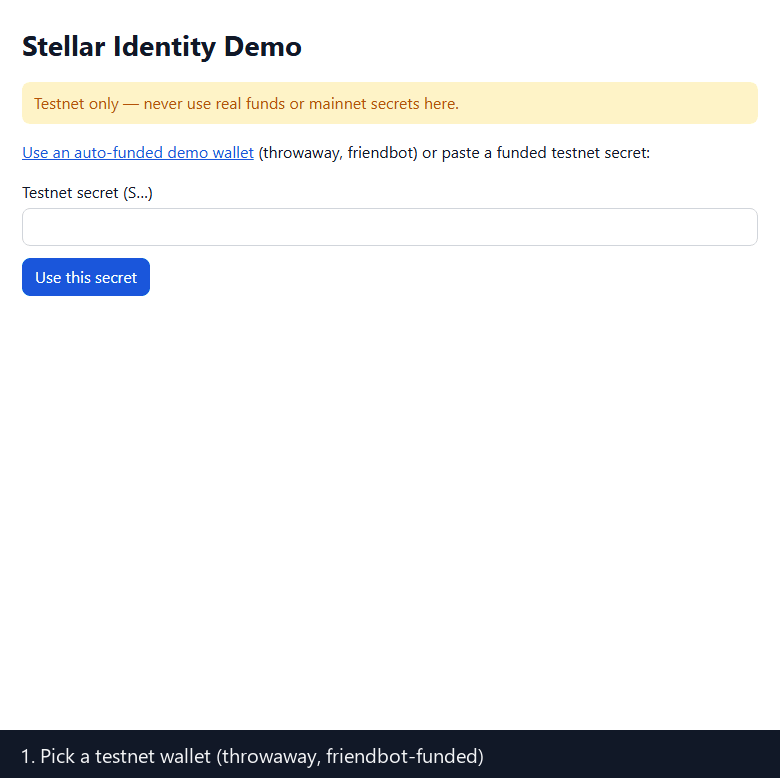
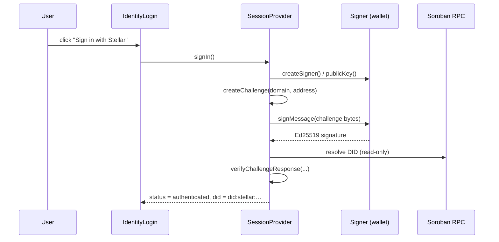

<div align="center">

# Stellar ID — Frontend

**Accessible, themeable React components and hooks for sign-in and identity UI on Stellar — built on the `stellar-id-client` SDK.**

[](https://github.com/Stellar-IDs/frontend/actions/workflows/ci.yml)


[](https://www.npmjs.com/package/stellar-id-frontend)

[](https://stellar-ids.github.io/frontend/)

**[Live demo](https://stellar-ids.github.io/frontend/)** · [Docs site](https://stellar-ids.github.io/docs/) · [Core contract](https://github.com/Stellar-IDs/core) · [Client SDK](https://github.com/Stellar-IDs/client) · [Docs repo](https://github.com/Stellar-IDs/docs) · [Roadmap](ROADMAP.md) · [Changelog](CHANGELOG.md)

</div>

> **Status — read this first.** Testnet only, v0.x. Published on npm as
> [`stellar-id-frontend@0.1.0`](https://www.npmjs.com/package/stellar-id-frontend). The sign-in flow
> has been exercised end to end in the demo with a **throwaway keypair**; it has **not** been verified with a
> real browser-extension wallet (Freighter, xBull, …). Try the **[hosted demo](https://stellar-ids.github.io/frontend/)**
> (testnet, throwaway wallet).

<p align="center">
  
</p>
<p align="center"><sub>Recorded from the hosted demo on testnet.</sub></p>

---

## Table of contents

1. [What this is](#what-this-is)
2. [Install](#install)
3. [Quick start](#quick-start)
4. [How sign-in works](#how-sign-in-works)
5. [Components](#components)
6. [Hooks](#hooks)
7. [Protecting routes](#protecting-routes)
8. [Theming](#theming)
9. [Accessibility](#accessibility)
10. [Next.js and SSR](#nextjs-and-ssr)
11. [The demo app](#the-demo-app)
12. [Development](#development)
13. [Project layout](#project-layout)
14. [Implemented, and not yet](#implemented-and-not-yet)
15. [Contributing, security and license](#contributing-security-and-license)

---

## What this is

`stellar-id-frontend` lets a React app offer **"Sign in with Stellar"** and show identity information
without writing wallet, DID or credential plumbing yourself. It wraps the
[`client`](https://github.com/Stellar-IDs/client) SDK in:

- a **session provider** that connects a wallet and runs the challenge/response sign-in,
- **components** for sign-in, a DID profile and a credential status badge,
- **hooks** that read DID documents and credential status with caching and de-duplication,
- a **route-gating** helper, and
- a small **CSS-variable theme** with light and dark values.

It deliberately brings no UI-library lock-in: plain React function components and plain CSS.

## Install

```bash
pnpm add stellar-id-frontend stellar-id-client @stellar/stellar-sdk@^16.4.1
```

React 18 or 19 is a peer dependency. `@stellar/stellar-sdk@^16.4.1` matches the client's own range, so a single
copy is installed.

## Quick start

```tsx
"use client";
import "stellar-id-frontend/styles.css";
import {
  SessionProvider,
  IdentityLogin,
  IdentityProfile,
} from "stellar-id-frontend";
import type { Signer } from "stellar-id-client";

export function App({ createSigner }: { createSigner: () => Promise<Signer> }) {
  return (
    <SessionProvider config={{ createSigner }}>
      <IdentityLogin onAuthenticated={(did) => console.log("signed in as", did)} />
      <IdentityProfile />
    </SessionProvider>
  );
}
```

`createSigner` is **yours**: it returns a `Signer` from `stellar-id-client` (for example a `WalletsKitSigner`
wrapping a connected wallet). The library never sees a secret key.

> **Prerequisite:** the signing account must already have an on-chain DID — create one with `createIdentity`
> from the client SDK. Signing in with an account that has none fails with `DidNotFoundError`.

## How sign-in works



The session moves through `disconnected → connecting → connected → authenticating → authenticated`,
or `error` (with a typed `StellarIdError`). The challenge is bound to your page's hostname by default
(override with `config.domain`) and the signature must verify against a key in the DID's `authentication`
relationship.

> **Important — this is a client-side session.** `SessionProvider` verifies the challenge **in the browser**
> and keeps its nonce store **in memory**. That is right for UI state (showing who is signed in) but it is
> **not** proof your backend can trust. For anything that grants access, send the challenge response to your
> server and run `verifyChallengeResponse` from `stellar-id-client` there with a shared nonce store, then issue
> your own session cookie or token.

## Components

| Component | What it renders | Notes |
|---|---|---|
| `IdentityLogin` | A "Sign in with Stellar" button that connects and signs in, and a sign-out control once authenticated | Props: `label`, `onAuthenticated(did)`. Progress and errors are announced through an `aria-live` region. |
| `IdentityProfile` | The signed-in (or given) DID's document: verification methods, relationships and services | Props: `did`, `network`, `resolve` (injectable for tests). Read-only. |
| `IdentityProfileView` | The presentational half of `IdentityProfile`, for when you already hold a resolution result | Use in stories and tests. |
| `CredentialBadge` | A status pill for a credential: **Valid**, **Revoked**, **Expired**, or **Unknown** | Props: `credential`, `network`, `refreshToken`, `verify` (injectable). Status is conveyed as text, not colour alone. |

## Hooks

| Hook | Returns | Purpose |
|---|---|---|
| `useSession()` | `{ status, address, did, error }` | Current session state |
| `useSessionActions()` | `{ connect, signIn, disconnect }` | Drive the session |
| `useIdentity()` | `{ did, address, status }` | The identity slice of the session |
| `useIdentityStatus()` | The status string plus booleans such as `isAuthenticated` | Cheap checks for rendering |
| `useDidDocument(did, opts?)` | `{ data, error, status, refetch }` | Resolve a DID document; cached and de-duplicated |
| `useCredential(credential, opts?)` | `{ data, error, status, refetch }` | Verify a credential and read its on-chain status |

`status` for the query hooks is one of the exported `QueryStatus` values. Pass `null` to stay idle.

## Protecting routes

```tsx
import { withAuth } from "stellar-id-frontend";

const Dashboard = withAuth(DashboardPage, {
  fallback: <p>Please sign in to continue.</p>,
});
```

`withAuth` renders its fallback until the session is authenticated. It is **UX only** — a determined user can
still call your API directly. Enforce access on the server.

## Theming

All colours, radius, font and spacing come from CSS variables prefixed `--sid-`. Component CSS contains **no
hard-coded colours**. Override any token in your own stylesheet:

```css
:root {
  --sid-color-primary: #7c3aed;
  --sid-radius: 0.25rem;
}
```

Dark mode follows the `data-sid-theme="dark"` attribute on `<html>` (or any ancestor); light is the default.

| Token group | Examples |
|---|---|
| Colour | `--sid-color-primary`, `-text`, `-muted`, `-background`, `-surface`, `-border` |
| State colour | `--sid-color-success`, `-warning`, `-error`, `-info` and their `-bg` pairs |
| Shape and type | `--sid-radius`, `--sid-font-family`, `--sid-spacing` |

Import the stylesheet once: `import "stellar-id-frontend/styles.css";`.

## Accessibility

Accessibility is a design constraint here, not a later pass:

- Controls are real `<button>`s with visible labels and a logical focus order; no keyboard traps.
- Status changes (connecting, signing, signed in, errors) are announced through `aria-live` regions.
- Credential state is text, never colour alone.
- ARIA is added only where native semantics are not enough.
- The unit tests include **axe** checks on the components.

This is *not* a formal accessibility audit (no screen-reader test matrix or WCAG conformance report yet), and
axe is not yet wired into Storybook.

## Next.js and SSR

Interactive modules start with `"use client"`, nothing touches `window` at import time, and the package can be
imported during server rendering. The [demo](#the-demo-app) is a Next.js (App Router) app that builds and
prerenders.

## The demo app

[`demo/`](demo/README.md) is a Next.js app that runs the whole flow against **testnet**:

1. choose a signer — an auto-funded throwaway keypair (`/?demowallet=1`, funded by Friendbot) or a pasted testnet secret,
2. register a `did:stellar` DID for it,
3. sign in with the challenge/response,
4. view the profile,
5. issue and anchor a credential, revoke it, and watch the `CredentialBadge` flip from **Valid** to **Revoked**.

Browser-extension wallets are **not wired into the demo yet**. Playwright end-to-end tests cover an offline run
and the full testnet flow.

**Hosted:** <https://stellar-ids.github.io/frontend/>, a static export deployed to GitHub Pages from `main` by
`.github/workflows/deploy.yml`.

```bash
cd demo
pnpm install
pnpm dev                                 # http://localhost:3000
DEMO_STATIC_EXPORT=1 pnpm build          # the static export that is deployed (out/, base path /frontend)
```

## Development

```bash
pnpm install --frozen-lockfile
pnpm lint
pnpm typecheck
pnpm test               # 26 unit tests, including axe checks
pnpm build              # ESM + CJS + types + styles.css
pnpm storybook          # http://localhost:6006

cd demo && pnpm build && pnpm e2e    # Playwright; the testnet test needs network access
```

> **Dependency note.** This package depends on `stellar-id-client ^0.1.0`, which installs from npm.

Conventions: function components, accessible by default, styling through CSS variables only, SSR-safe modules,
a happy-path and a failure-path test for every public export.

## Project layout

```
src/
├── session/SessionProvider.tsx   # connect + sign-in state machine, session hooks
├── hooks/useStellarQueries.ts    # useDidDocument, useCredential
├── components/
│   ├── IdentityLogin.tsx         # + .css, .stories.tsx
│   ├── IdentityProfile.tsx       # + IdentityProfileView
│   ├── CredentialBadge.tsx
│   └── withAuth.tsx
├── theme/variables.css           # --sid-* tokens, light + dark
└── index.ts                      # public API
demo/                             # Next.js demo + Playwright e2e
.github/workflows/                # ci.yml (verify), deploy.yml (demo → GitHub Pages)
```

## Implemented, and not yet

**Implemented and tested:** session provider with challenge sign-in, `IdentityLogin`, `IdentityProfile`,
`CredentialBadge`, query hooks with caching, `withAuth`, CSS-variable theming with dark mode, Storybook stories
for the three main components, the Next.js demo and its e2e tests.

**Not yet — planned as open contributor issues** (extension points are marked `TODO(wave: frontend-N)`):

| Issue | Idea |
|---|---|
| frontend-1 | Social / passkey login fallback |
| frontend-2 | Profile editing UI: manage keys and services |
| frontend-3 | Theme customization: presets, provider API, high contrast |
| frontend-4 | Accessibility audit (WCAG 2.2 AA) |

**Also not present:** a hosted demo, a formal accessibility audit, and server-side session handling (by design —
that belongs to your backend).

## Contributing, security and license

Contributions are welcome — see [CONTRIBUTING.md](CONTRIBUTING.md) and the
[Code of Conduct](CODE_OF_CONDUCT.md). Vulnerabilities go through [SECURITY.md](SECURITY.md).

Licensed under the [Apache License 2.0](LICENSE).
